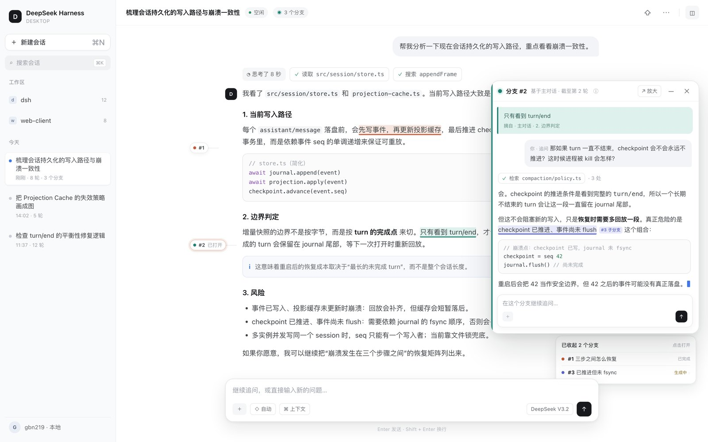
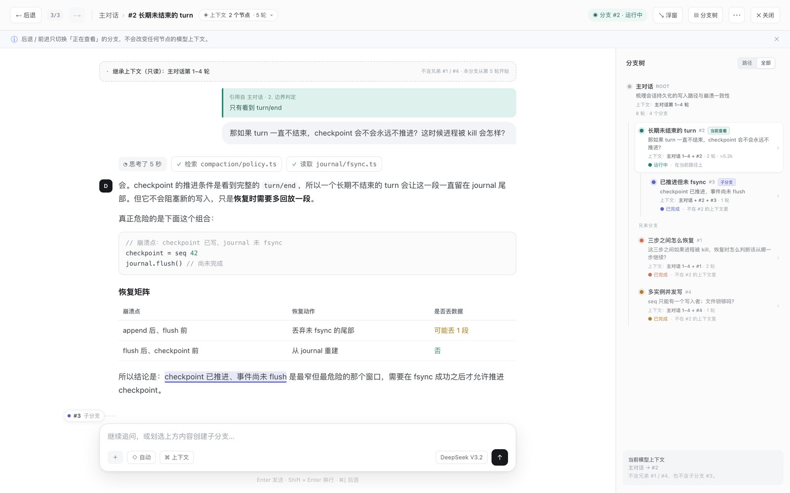
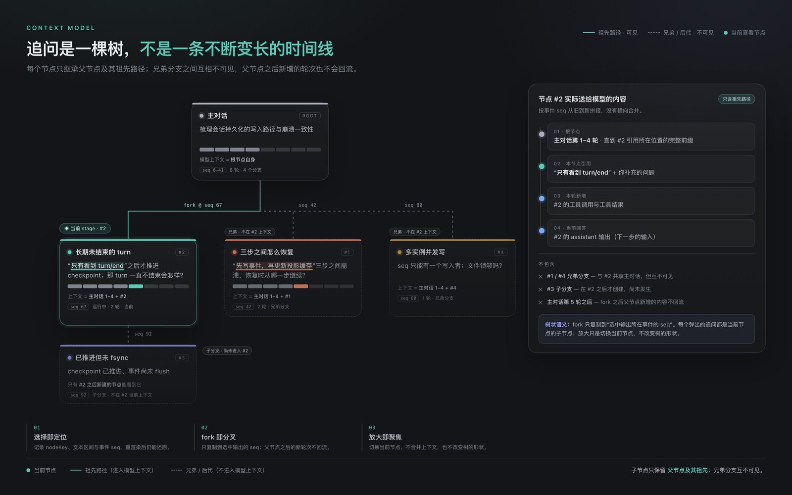

# 输出内追问 · Inline follow-up

> 在 DeepSeek Harness 的回答里划一句话，就地追问；每个追问都是一条真实的 Session 分支，拥有一棵只向祖先继承的上下文树。

[](https://github.com/deepseek-ai/deepseek-harness)
[](LICENSE)


`dsh-inline-followup` 是一个 DeepSeek Harness（DSH）UI 插件：在已完成的 assistant 回答中划选文字，输入一个追问，插件会在选中事件处 fork 出一条真实 Session 分支，并用浮窗、舞台和分支树来浏览这些分支。



> 上图为设计示意。当前版本的新建追问只弹出一个输入浮窗；发送后，已创建的分支才显示完整对话浮窗。

---

## 目录

- [为什么需要它](#为什么需要它)
- [功能](#功能)
- [界面](#界面)
- [安装](#安装)
- [使用](#使用)
- [上下文模型](#上下文模型)
- [数据与隐私](#数据与隐私)
- [兼容性与限制](#兼容性与限制)
- [FAQ](#faq)
- [License](#license)
- [English](#english)

---

## 为什么需要它

在长回答里追问一个局部细节时，通常只有两种选择：

- 继续在主对话里问，问题越堆越多，上下文被稀释；
- 复制到新会话，丢失原文和上下文。

输出内追问把两者折中：**原文留在主对话，问题进入独立分支**。每个分支是真实的 DSH Session，能继续使用原生思考、工具调用、Stop 和 Composer；同时只继承它该看到的祖先路径。

适合：

- 精读长回答，对某一段反复追问；
- 在同一段输出上比较多个方向；
- 从某个结论继续派生更细的子问题，而不污染主对话。

## 功能

- **划选即追问**：在已完成的 assistant 回答中划选文字，点 `✦ 追问`，输入问题。
- **真实 Session 分支**：在每个追问的 durable anchor seq 处 fork；分支不是假消息，也不是另一个前端页面。
- **多分支并存**：同一段输出可以创建多个分支，每个分支有稳定的颜色和编号。
- **原文标记**：隐藏浮窗后，原文保留同色下划线和行尾 `#n`；标记随正文原生滚动。
- **收起列表**：右下角列出所有分支，点击即可打开并精确滚动到原文。
- **独立输入浮窗**：新建追问只显示一个输入浮窗，不再重复显示引用块。
- **可拖动、可缩放**：对话浮窗和草稿输入浮窗分别记忆位置和尺寸。
- **舞台**：把分支放大到主区域，支持后退/前进、面包屑、分支树、还原和关闭。
- **树状上下文**：子分支只继承父节点及祖先；兄弟分支互不可见；父节点之后新增的轮次不会回流。
- **左侧栏折叠**：分支 Session 在左侧栏归入 `追问分支` 分组，可一键收起。
- **草稿可删除**：未发送草稿可从输入浮窗、收起列表、舞台分支树删除；已创建分支不提供删除。
- **主题与桌面适配**：浅色/深色主题；macOS 舞台避开红黄绿窗口按钮；支持窗口拖拽区外的点击。

## 界面

### 多分支与收起列表


同一段回答可以派生多个分支；收起浮窗后，原文以不同颜色标记，右下角保留可操作入口。

### 舞台与分支树



舞台把分支放大到主区域，左侧栏保持可见；顶部的 `主对话 › #n` 面包屑可点击，右侧分支树按父子关系缩进展示。

### 上下文模型



每次 fork 只复制选中位置之前的完整前缀。子节点看到祖先路径，不看到兄弟，也不看到父节点之后新增的内容。

> 以上为设计示意图，实际文案、按钮位置和浮窗拆分方式以当前版本为准。

## 安装

### 前置条件

- DeepSeek Harness **0.2.2-rc.x**（当前 `engines.dsh`：`>=0.2.2-0 <0.3.0`）；
- DSH Web 或 DSH Desktop；
- 不需要构建步骤，包内直接包含 `client.js`。

### 从 npm 安装

```sh
dsh plugin --profile web add dsh-inline-followup
# 或 Desktop 使用的 profile 名称
dsh plugin --profile desktop add dsh-inline-followup
```

### 从 GitHub 安装

```sh
dsh plugin --profile web add github:gbn0219/dsh-inline-followup
```

这是纯 JavaScript 包，不需要 `prepare` 构建授权。

### 从本地目录安装

```sh
dsh plugin --profile web add /absolute/path/to/dsh-inline-followup
```

也可以在 DSH Desktop 的 **插件 → 添加插件** 中选择本地目录。

### 安装后

1. 完全退出并重开 DSH Desktop，或刷新 Web 页面（`Cmd/Ctrl + Shift + R`）。
2. 打开 **插件**，确认 `Inline follow-up` 已启用，且图标/详情正常。
3. 在一个**已完成**的回答中划选文字开始使用。

## 使用

### 1. 新建追问

1. 在一条已生成完成的 assistant 回答中划选文字；
2. 点选区附近出现的 `✦ 追问` 胶囊；
3. 在弹出的输入浮窗中输入问题，按 `Enter` 或「发送」；
4. 发送成功后输入浮窗消失，分支浮窗显示原生对话和底部 Composer。

> 流式生成中的回答、用户消息、工具参数编辑区和浮窗自身不可作为追问锚点。

### 2. 标记与恢复

- 收起（`—`）或关闭（`✕`）分支后，原文保留彩色下划线和行尾 `#n`；
- 右下角 `已收起分支` 列表显示编号、问题摘要和状态；
- 点击列表一行会打开对应浮窗，并把**划线原文**滚到视口中央；
- 点击 `#n` 标记也可以打开分支。

### 3. 子分支

在分支回答中继续划选，可以创建子分支。子分支只继承该分支及其祖先的上下文；不会看到兄弟分支，也不会看到父节点之后新增的轮次。

点击已收起列表中的子分支时：

- 祖先分支会以**舞台**形式显示；
- 子分支以**浮窗**叠在舞台上；
- 不再同时打开两个浮动对话窗。

### 4. 舞台

浮窗头部的 `↗` 打开舞台：

- `← 后退` / `前进 →`：切换正在查看的分支；在第一个舞台节点上后退返回主对话；
- `主对话 › #n` 面包屑：点击跳到对应层；
- `▤ 分支树`：打开右侧树，按父子关系缩进；
- `↘ 还原为浮窗`：回到紧凑浮窗；
- `✕ 关闭`：回到主对话。

舞台不覆盖左侧栏；macOS 下从窗口标题栏下方开始，避开红黄绿按钮。

### 5. 草稿删除与分支保留

- **草稿**（尚未发送、尚未 fork Session）：输入浮窗头部、收起列表行、舞台分支树行都有红色 `⌫`；
- **已创建分支**：不提供删除入口，只能收起/关闭；需要清理时在 DSH Session 列表中归档；
- 删除草稿只删除插件的 UI 记录，不会删除任何 Session（草稿还没有 Session）。

### 6. 左侧栏折叠

分支是真实 Session，会出现在左侧栏。插件会为这些行插入一个 `追问分支 · n` 分组头：

- 点击分组头收起/展开；
- 只隐藏追问分支行，不影响主对话和其他 Session；
- 折叠状态保存在本地。

## 上下文模型

```text
主对话
├── #1  从主对话的 seq 67 fork
│   └── #3  从 #1 的 seq 92 fork
└── #2  从主对话的 seq 42 fork
```

- `#1` 看到：主对话前缀 + #1 自己的输入/回答；
- `#2` 看到：主对话前缀 + #2 自己的输入/回答；看不到 #1、#3；
- `#3` 看到：主对话前缀 + #1 的前缀 + #3 自己的内容；看不到 #2；
- 父节点在 fork 之后追加的新轮次，不会自动出现在子分支里；
- 分支之间没有合并操作。

实现上：

1. `ctx.sessions.fork({ sessionId, atSeq })` 复制 durable 前缀；
2. `SessionProvider` 绑定新 Session；
3. 用 `conversation.content` 的 embedded variant 渲染原生对话；
4. 继承前缀仍在 Session 日志和模型上下文中，只是 UI 通过 DOM 过滤隐藏了祖先行。

## 数据与隐私

- **不发起网络请求**，不包含遥测、分析或远程资源；
- 分支树元数据（编号、颜色、锚点、浮窗位置）保存在浏览器 `localStorage` 的 `dsh.inline-followup.v1`；
- 分支的对话内容保存在 DSH Session 日志中，和普通 Session 一样；
- 插件不读取工作区文件内容；只读取聊天 DOM 中的文本区间；
- 卸载插件不会删除已经创建的分支 Session；需要时在 DSH 中归档/删除；清除 `dsh.inline-followup.v1` 可清除插件的 UI 记录。

## 兼容性与限制

- **DSH**：0.2.2-rc.x；`engines.dsh` 会在安装/启动时检查。
- **平台**：以 DSH Desktop 为主要测试环境；Web 共用 UI 插件机制，但窄屏体验尚未专项打磨。
- **主题**：浅色/深色；强调色、下划线、浮窗和分支树都使用 DSH 主题变量。
- **继承前缀**：模型可见，UI 隐藏；当前不是可展开的上下文查看器。
- **已创建分支**：不能从插件删除；只能在 DSH Session 列表中归档。
- **分支 Sessions**：会出现在左侧栏（已有可折叠分组），也会出现在普通 Session 搜索/列表中。
- **DOM 依赖**：通过 `data-chat-node-key`、`data-text-interaction-source`、`data-conversation-scroll` 等 DSH DOM 约定定位文本；DSH 大版本升级可能需要适配。
- **运行时文案**：0.1.8 的浮窗/舞台按钮文案目前为中文；Plugin Manager 的标题和描述已提供中英文。
- **没有跨设备同步**：分支树 UI 元数据只在本浏览器；Session 本身同步于 DSH Host。
- **没有合并/改写**：不支持把兄弟分支答案拼进当前上下文，也不支持原地编辑历史问题。

## FAQ

**为什么左侧栏多出了会话？**  
每个分支是真实 fork Session。左侧栏会把它们归入可折叠的 `追问分支` 分组；折叠只隐藏这些行。

**能删除已发送的分支吗？**  
不能从插件删除。已创建分支保留真实 Session，请在 DSH 的 Session 列表中归档。只有未发送草稿可以 `⌫` 删除。

**分支会看到兄弟分支吗？**  
不会。只继承父节点及祖先路径；父节点之后新增的轮次也不会自动回流。

**为什么点击 #1/#2 没有跳到原文？**  
插件会优先用真实 Range 居中；如果 Turn 尚未挂载，会触发 DSH turn 导航加载。若仍失败，通常说明目标 Turn 被折叠在未加载的历史里，或页面 DOM 结构已变化。

**它会把我的对话发到别的服务吗？**  
不会。插件不发起网络请求；分支对话由 DSH 自己的 Session/模型链路处理。

**支持哪些 DSH 版本？**  
当前针对 0.2.2-rc.x 开发和验证；`engines.dsh` 会阻止不兼容版本安装。

## License

[MIT](LICENSE) © 2026 gbn0219

---

## English

`dsh-inline-followup` is a client-side DSH plugin for **selection-based follow-up branches**.

Select text in a completed assistant answer, choose the `✦ 追问` chip, type a question, and the plugin forks a real Session at the selected durable anchor. The branch is rendered with the shared Conversation UI, so native reasoning, tool calls, Stop, and the composer remain available.

### Highlights

- One answer → many stable, colored branches.
- Real Session forks at the exact durable event.
- Colored underlines + `#n` markers that scroll with the transcript.
- Branch dock, draggable/resizable panels, and a full stage with breadcrumbs, history, and a depth-first branch tree.
- Exact-range centering when restoring a branch.
- A collapsible `追问分支` group in the left sidebar.
- New drafts open one compact input window; sent branches use one panel with the native composer.
- Draft-only deletion; sent branches are kept as real Sessions.
- Context is a tree: a child sees its ancestors, siblings never see each other.

### Install

```sh
dsh plugin --profile web add dsh-inline-followup
# or
dsh plugin --profile web add github:gbn0219/dsh-inline-followup
```

Restart DSH or hard-refresh the Web page. Requires DSH `>=0.2.2-0 <0.3.0`.

### Limitations

Desktop-focused; runtime UI labels are Chinese in 0.1.8 (Plugin Manager metadata is localized); branch Sessions still appear in the normal Session list (with the collapsible group); inherited context is loaded by the model but hidden in the UI; sent branches cannot be deleted from the plugin; no merge between branches; no cross-device branch-tree sync.

MIT licensed. See [CHANGELOG.md](CHANGELOG.md) for release history.
